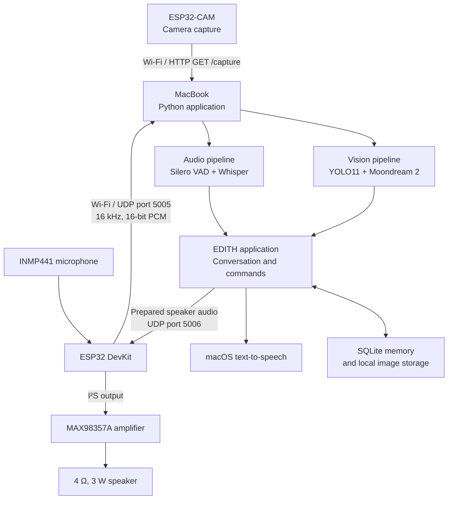

# EDITH --- AI-Powered Smart Glasses

> **EDITH** is an experimental wearable AI assistant built into a pair
> of smart glasses. It combines computer vision, voice interaction, and
> local long-term memory to help a wearer ask questions about their
> surroundings and interact with an AI assistant hands-free.

**Project status:** Science-fair prototype\
**Production freeze:** 23 November 2026\
**Demonstration date:** 28 November 2026

------------------------------------------------------------------------

## Project at a glance

EDITH connects a camera and microphone system to a MacBook-based AI
application. The camera provides images for visual analysis, while the
ESP32 DevKit streams microphone audio to the computer. The computer
handles speech recognition, AI processing, memory, and text-to-speech. A
separate ESP32 audio path is prepared to receive speaker audio.

### Reference images

The following images document parts of the prototype electronics and its
circuit design. They are not photographs of the final assembled glasses.

```{=html}
<p align="center">
```
``{=html}
`<br>`{=html} `<em>`{=html}ESP32 DevKit and breadboard
prototype.`</em>`{=html}
```{=html}
</p>
```
```{=html}
<p align="center">
```
``{=html}
`<br>`{=html} `<em>`{=html}EDITH circuit reference
diagram.`</em>`{=html}
```{=html}
</p>
```
> **Add the completed glasses photograph here:** once the final camera,
> microphone, wiring, battery arrangement, and speaker assembly have
> been mounted, add a photograph of the complete prototype to this
> section.

------------------------------------------------------------------------

## What EDITH is designed to do

-   **Live conversational intelligence:** use Gemini Live for
    camera-grounded, natural-language conversations and native spoken
    responses.
-   **Object detection:** use YOLO11 to identify and locate objects in a
    camera image.
-   **Local visual question answering:** use Moondream 2 as a local
    fallback for detailed image analysis when Gemini Live is unavailable.
-   **Voice input:** receive microphone audio from an INMP441 microphone
    connected to an ESP32 DevKit.
-   **Speech recognition:** use Whisper to transcribe spoken input.
-   **Voice activity detection:** use Silero VAD to help identify speech
    segments.
-   **Spoken responses:** use macOS text-to-speech for the computer's
    voice output.
-   **Long-term memory:** store and retrieve selected information and
    interaction history using a local SQLite database.
-   **Automatic visual memory:** save captured images and associated
    metadata locally.

The feature set is intended for a controlled science-fair demonstration.
EDITH is a prototype, not a certified assistive, safety, or navigation
device.

------------------------------------------------------------------------

## System architecture

EDITH uses a split architecture: the ESP32 boards handle sensor and
audio transport, while the MacBook runs the main Python application and
AI models.



### Data paths

  -----------------------------------------------------------------------
  Function                            Data path
  ----------------------------------- -----------------------------------
  Camera input                        ESP32-CAM → Wi-Fi HTTP → MacBook

  Microphone input                    INMP441 → ESP32 DevKit → UDP `5005`
                                      → MacBook

  Speaker output path                 MacBook → UDP `5006` → ESP32 DevKit
                                      → I²S → amplifier → speaker

  Memory                              Python application → local SQLite
                                      database and image directory
  -----------------------------------------------------------------------

The speaker path has been tested for UDP reception and I²S writes.
Physical speaker playback remains pending installation and verification
of the correct MAX98357A amplifier.

------------------------------------------------------------------------

## Hardware

### Main components

  -----------------------------------------------------------------------
  Component               Role                    Status
  ----------------------- ----------------------- -----------------------
  ESP32 DevKit V1         Microphone streaming    Firmware tested
                          and speaker-audio       
                          receiver                

  AI-Thinker ESP32-CAM    Camera capture and HTTP Firmware tested
                          image server            

  INMP441                 I²S digital microphone  Working

  MAX98357A               I²S digital audio       Correct module pending
                          amplifier               purchase

  4 Ω, 3 W speaker        Audio output            Playback not yet
                                                  verified

  Battery and power       Portable power          Power/boost assembly
  circuitry                                       already soldered
  -----------------------------------------------------------------------

The battery is intended to be carried in a pocket rather than mounted
directly on the glasses. The glasses are intended for a science-fair
demonstration, not use during laboratory work.

### ESP32 DevKit pin configuration

**INMP441 microphone --- I²S 0**

  Signal         ESP32 GPIO
  ------------ ------------
  BCLK / SCK             26
  WS / LRCL              25
  DATA / SD              33

**Speaker I²S output --- I²S 1**

  Signal         ESP32 GPIO
  ------------ ------------
  BCLK                   27
  WS / LRCLK             14
  DATA OUT               22

The microphone and speaker use separate I²S controllers. Their firmware
tasks are independent.

### Audio transport configuration

  Setting                           Value
  --------------------------------- ------------
  Microphone sample rate            16,000 Hz
  Microphone transmitted format     16-bit PCM
  Microphone UDP destination port   `5005`
  Speaker sample rate               16,000 Hz
  Speaker input format              16-bit PCM
  Speaker UDP listening port        `5006`

### ESP32-CAM

-   Board: AI-Thinker ESP32-CAM
-   Image size: VGA, 640 × 480
-   Image format: JPEG
-   Connection: Wi-Fi
-   HTTP endpoint: `GET /capture`
-   Camera orientation: configured with vertical and horizontal flip in
    firmware

The MacBook application uses the `/capture` endpoint. Keep this endpoint
unchanged unless the Python client is updated at the same time.

------------------------------------------------------------------------

## Software and AI components

  Component                  Purpose
  -------------------------- ---------------------------------------------------
  Python 3.12                Main application runtime
  PyTorch                    Machine-learning runtime
  YOLO11s                    Object detection
  Gemini Live                Live camera-grounded conversation and native audio
  Moondream 2                Local visual question-answering fallback
  Whisper                    Speech-to-text
  Silero VAD                 Voice activity detection
  macOS text-to-speech       Spoken assistant responses
  SQLite                     Local structured memory
  Arduino-ESP32 core 4.0.0   ESP32 firmware environment

The project has been developed and tested on an Apple MacBook Pro with
an M1 chip and 8 GB unified memory. Actual performance can vary with
model settings, image size, and background applications.

------------------------------------------------------------------------

## Project structure

The main application is organised into the following areas:

``` text
AI Goggles/
├── brain/
│   ├── main.py
│   ├── audio.py
│   ├── brain.py
│   └── memory.py
├── firmware/
│   ├── edith_devkit_final.ino
│   └── edith_camera_final.ino
├── models/
│   └── yolo/
│       ├── yolo11n.pt
│       └── yolo11s.pt
├── memory/
│   ├── edith_memory.db
│   └── images/
├── temp/
└── .env
```

The `firmware/` directory is the recommended archive location for the
final ESP32 sketches. The exact contents of the local project may differ
as development continues.

### Important local-only files

The following should remain local and should not be committed to a
public or shared repository:

-   `.env` and any file containing API keys, Wi-Fi passwords, or other
    secrets.
-   Python virtual environments such as `.venv312/`.
-   Personal conversation databases and saved visual memories.
-   Captured images that may contain people or private surroundings.
-   Temporary audio, logs, and test recordings.

Use a `.gitignore` file to exclude these items. Do not rely on
`.gitignore` alone if a sensitive file has already been staged or
committed; remove it from the Git index and rotate any exposed
credentials.

------------------------------------------------------------------------

## Gemini Live integration

Gemini Live is the primary conversational model when a Gemini API key is
configured. EDITH keeps its local command handlers: YOLO handles explicit
object-detection requests, SQLite handles stored memories, and Moondream
remains available as a local visual fallback. The camera feed is sent to
Gemini at approximately one frame per second, matching the Live API limit.
Whisper recognises speech for EDITH's local command routing. When a
request is sent to Gemini, EDITH also forwards the original 16 kHz
microphone PCM utterance alongside the live camera frames. Gemini's native
audio response is played locally or streamed to the ESP32 speaker.

Install the optional Gemini dependency in the existing virtual environment:

```bash
python -m pip install -r requirements-gemini.txt
```

Add these settings to the local, untracked `.env` file. Keep the API key
private and never commit it:

```env
GEMINI_API_KEY=your_gemini_api_key
GEMINI_LIVE_MODEL=gemini-3.8-live
EDITH_GEMINI_LIVE_ENABLED=true
```

For Mac-only testing, set `EDITH_DESKTOP_MODE=true` and
`EDITH_IMAGE_PATH=/absolute/path/to/test.jpg`. EDITH will repeatedly send
that local image as its camera source. For the wearable, leave
`EDITH_IMAGE_PATH` unset and configure `CAMERA_URL` or
`CAMERA_STREAM_URL` for the ESP32-CAM.

## Setup overview

These instructions describe the intended setup. Exact package versions
and any provider credentials should be taken from the project's current
dependency and configuration files.

1.  Install Python 3.12 and create a virtual environment.
2.  Install the Python dependencies required by the application.
3.  Configure local environment variables in `.env` without committing
    that file.
4.  Place the required model files in the expected `models/`
    directories.
5.  Flash the final DevKit firmware to the ESP32 DevKit V1.
6.  Flash the final camera firmware to the AI-Thinker ESP32-CAM.
7.  Configure the ESP32 boards and MacBook to use the same Wi-Fi
    network.
8.  Confirm the camera's `/capture` endpoint is reachable from the
    MacBook.
9.  Start the EDITH application using the project's configured entry
    point.

**Network configuration:** the firmware and Python application must
agree on the MacBook's local IP address, Wi-Fi network, and UDP ports.
Do not publish Wi-Fi credentials or API keys in the repository.

------------------------------------------------------------------------

## Testing and verification record

The following functions have been exercised during prototype
development:

-   ESP32-CAM initialisation, Wi-Fi connection, HTTP server startup, and
    VGA image capture.
-   Microphone I²S input and UDP transmission to the MacBook.
-   Speaker UDP packet reception and I²S writes on the DevKit.
-   Simultaneous microphone and speaker communication tasks.
-   Microphone clarity while speaker test packets are being received.
-   Wi-Fi disconnection and reconnection, followed by UDP socket
    recovery.
-   Local memory storage and retrieval during software testing.

**Not yet verified:** physical speaker playback through the final
MAX98357A amplifier and speaker assembly.

Testing on a prototype does not guarantee reliability in every
environment. Re-test the complete system after any firmware, wiring,
power, network, or software change.

------------------------------------------------------------------------

## Safety and limitations

-   EDITH is an educational prototype and is not a certified medical,
    accessibility, industrial, or safety device.
-   Do not rely on its object detection or scene descriptions for
    hazardous tasks.
-   Do not wear or operate the prototype during laboratory work.
-   Keep exposed conductors insulated and secure the battery and power
    circuitry safely.
-   Avoid short circuits, loose wiring, and placing unprotected
    electronics or batteries directly against skin.
-   Obtain permission before capturing or storing images or audio of
    other people.
-   Keep credentials, personal memories, and private recordings out of
    public repositories.

------------------------------------------------------------------------

## Project history

EDITH was developed as a student science-fair engineering project. Its
development involved integrating embedded hardware, wireless
communication, computer vision, speech processing, and local memory into
one wearable prototype.

The production-freeze milestone is intended to preserve a known-working
version before final physical assembly and demonstration preparation.

### Production archive

-   **Project:** EDITH --- AI-Powered Smart Glasses
-   **Release label:** `v1.0 — Science Fair Production`
-   **Production freeze:** 23 November 2026
-   **Science-fair demonstration:** 28 November 2026

------------------------------------------------------------------------

## Acknowledgements

Built through experimentation, debugging, hardware integration, and
software development.

**EDITH --- an experiment in making AI wearable.**
