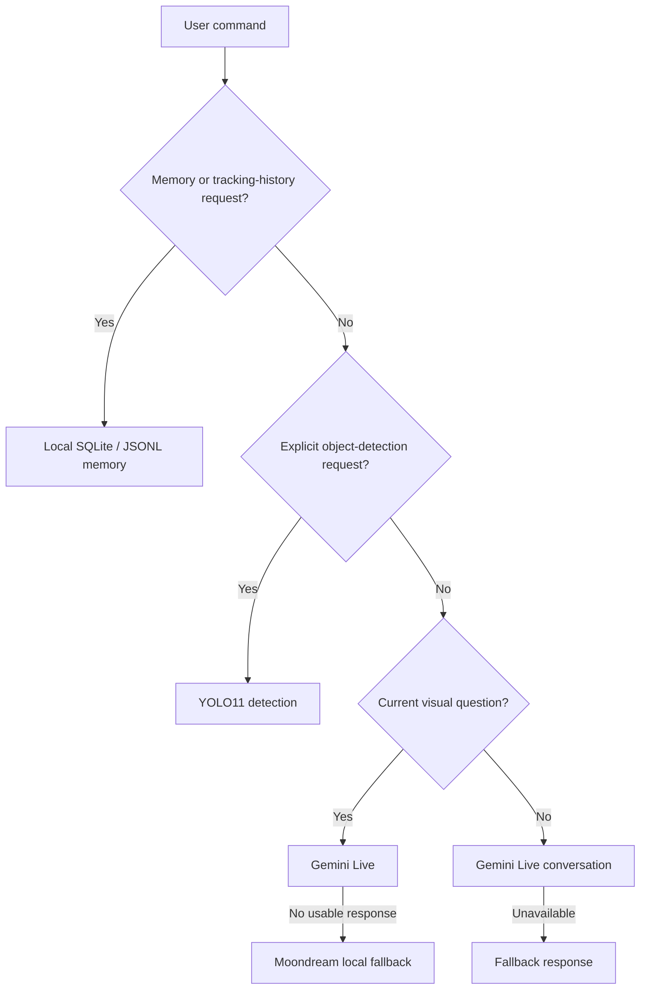
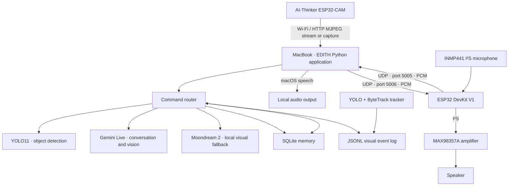

# EDITH — AI-Powered Smart Glasses

<p align="center">
  <strong>A wearable, camera-aware AI assistant built with ESP32 hardware, Python, computer vision, and conversational AI.</strong>
</p>

<p align="center">
  
  
  
  
  
</p>

EDITH is an experimental smart-glasses project designed to let a wearer ask questions about the world around them, interact with an AI assistant, and build a record of selected visual events and memories.

The system combines an **ESP32-CAM**, an **ESP32 DevKit with an I²S microphone**, and a **Mac-based Python application**. The computer handles AI inference, speech processing, conversation routing, and persistent memory. Gemini Live provides cloud-based conversational and visual understanding, while YOLO and Moondream provide local computer-vision capabilities.

> **Project status:** Active engineering prototype. Hardware and software capabilities are at different stages of testing. This is not a certified assistive, safety, medical, or navigation device.

---

## Contents

- [Highlights](#highlights)
- [How the AI systems work together](#how-the-ai-systems-work-together)
- [System architecture](#system-architecture)
- [Hardware](#hardware)
- [Software stack](#software-stack)
- [Repository structure](#repository-structure)
- [Getting started](#getting-started)
- [Configuration](#configuration)
- [Running EDITH](#running-edith)
- [Example commands](#example-commands)
- [Visual tracking and event memory](#visual-tracking-and-event-memory)
- [Memory and privacy](#memory-and-privacy)
- [Performance notes](#performance-notes)
- [Testing](#testing)
- [Known limitations and verification status](#known-limitations-and-verification-status)
- [Safety](#safety)
- [Roadmap](#roadmap)
- [Acknowledgements](#acknowledgements)

---

## Highlights

- **Gemini Live conversational AI** — a persistent Live API session for natural-language questions, camera-grounded answers, and native audio responses.
- **Continuous visual context** — EDITH sends camera frames to Gemini Live at approximately one frame per second.
- **YOLO11 object detection** — identifies supported object classes and estimates their positions in the image.
- **Moondream 2 local vision** — provides local image question-answering when Gemini is unavailable or cannot return a usable response.
- **Voice interaction pipeline** — ESP32 microphone audio is transported to the Mac, segmented with Silero VAD, and transcribed with Whisper.
- **Two output paths** — local macOS speech output during desktop development, and a UDP/I²S path prepared for the ESP32 speaker.
- **Persistent SQLite memory** — stores conversations, visual-memory records, and explicit user-approved memories.
- **Visual event tracking** — YOLO tracking and ByteTrack produce timestamped object appearance, movement, and disappearance events.
- **Mac-only development mode** — test the conversational pipeline with a local image without requiring the ESP32-CAM, microphone, or speaker hardware.

## How the AI systems work together

EDITH does not send every request to every model. Its command router selects a system based on the kind of request.

| User request | Main handler | What happens |
|---|---|---|
| “What can you see?” / “Detect objects” | YOLO11 | Detects objects and reports their approximate image positions. |
| “What colour is the hammer?” | Gemini Live | Answers a current-scene visual question using the streamed camera context. |
| “Describe my surroundings.” | Gemini Live | Produces a concise description grounded in recent camera frames. |
| Visual question when Gemini is unavailable | Moondream 2 | Captures an image and analyses it locally. |
| “What did you see earlier?” | SQLite visual memory | Retrieves previously saved visual descriptions. |
| “Remember that my laptop is silver.” | Explicit memory handler | Requests confirmation, then saves the memory locally. |
| “Did anything move?” | Visual event memory | Searches the local tracking-event log. |
| General conversation | Gemini Live | Handles conversational requests that do not match a local command. |

### The role of each model

**YOLO11 — detection and localisation**

YOLO is the deterministic object-detection component. It returns detected classes and bounding boxes. EDITH uses those boxes to estimate whether an object is on the left, centre, or right, and in the upper, middle, or lower part of the image. Detection is not the same as understanding: YOLO does not provide the same open-ended reasoning as a vision-language model.

The main detection pipeline currently loads `models/yolo/yolo11n.pt`. The separate visual-tracking program uses `models/yolo/yolo11s.pt`.

**Gemini Live — primary conversational brain**

When enabled and connected, Gemini Live handles general conversation and current-scene visual questions. EDITH maintains a persistent session and sends camera frames as visual context. Text questions and recorded audio inputs are sent through the same ordered session-input path. Gemini can return text and native audio.

**Moondream 2 — local visual fallback**

Moondream runs locally on the Mac through the project's PyTorch/Transformers stack. EDITH loads it lazily for a visual question when Gemini is unavailable or does not return a usable response. The model is released after an idle period and before YOLO detection to reduce memory pressure.

**Important:** this is the routing implemented in the current code, not a claim that all three models run simultaneously. The Mac has limited unified memory, so the application deliberately manages local model loading.

### Current command-routing flow



---

## System architecture

The prototype separates sensor transport from the AI application. The ESP32 boards handle camera, microphone, and speaker I/O. The Mac runs Python, model inference, speech processing, and memory.



### Data paths

| Function | Data path |
|---|---|
| Gemini camera context | ESP32-CAM MJPEG stream → Python camera reader → Gemini Live |
| Local image capture | ESP32-CAM `/capture` endpoint → Python vision pipeline |
| Microphone input | INMP441 → ESP32 DevKit → UDP `5005` → Silero VAD → Whisper |
| Gemini audio request | Recognised utterance's original 16 kHz PCM audio → Gemini Live |
| Local visual analysis | Captured image → YOLO11 or Moondream |
| Speaker output | Mac → UDP `5006` → ESP32 DevKit → I²S → amplifier → speaker |
| Memory | Python application → SQLite database, image files, and JSONL event log |

The live Gemini camera reader and the local image-capture path are separate readers of the configured image source. For a real camera, the project uses the camera stream for Gemini Live and the configured capture endpoint for local analysis.

---

## Hardware

### Main components

| Component | Role | Current development status |
|---|---|---|
| AI-Thinker ESP32-CAM | Camera capture and Wi-Fi image streaming | Camera firmware and stream tested |
| ESP32 DevKit V1 | Microphone transport and speaker-audio receiver | Firmware communication paths tested |
| INMP441 | I²S digital microphone | Microphone input tested |
| MAX98357A | I²S audio amplifier | Correct module / final installation pending |
| 4 Ω, 3 W speaker | Audio output | Final physical playback not yet verified |
| Battery and power circuitry | Portable power | Power/boost assembly prepared |

The battery is intended to be carried separately rather than mounted directly on the glasses. The final wearable assembly and its power arrangement must be checked before use.

### Prototype reference images

These images document parts of the electronics prototype and circuit design. They are not photographs of the completed glasses.

<p align="center">
  
  <br>
  <em>ESP32 DevKit and breadboard prototype.</em>
</p>

<p align="center">
  
  <br>
  <em>Electronics circuit reference diagram.</em>
</p>

A photograph of the completed glasses assembly can be added here after the final camera, microphone, wiring, battery arrangement, and speaker assembly have been mounted.

### ESP32 DevKit pin configuration

**INMP441 microphone — I²S input**

| Signal | ESP32 GPIO |
|---|---:|
| BCLK / SCK | 26 |
| WS / LRCL | 25 |
| DATA / SD | 33 |

**Speaker — I²S output**

| Signal | ESP32 GPIO |
|---|---:|
| BCLK | 27 |
| WS / LRCLK | 14 |
| DATA OUT | 22 |

The microphone and speaker use separate I²S controllers in the current firmware design.

### Audio transport configuration

| Setting | Value |
|---|---|
| Microphone sample rate | 16,000 Hz |
| Microphone format | 16-bit PCM, mono |
| Microphone UDP destination | Port `5005` |
| Speaker sample rate | 16,000 Hz |
| Speaker format | 16-bit PCM |
| Speaker UDP listener | Port `5006` |
| ESP32 speaker IP in current Python configuration | `10.0.100.41` |

The speaker IP is currently configured directly in `brain/audio.py`. If the DevKit receives a different local IP address, update the configuration in the code before testing speaker output.

### ESP32-CAM configuration

- Board: AI-Thinker ESP32-CAM.
- Camera image size in the local vision pipeline: 640 × 480.
- Image format: JPEG.
- Network: Wi-Fi.
- Local capture endpoint: `GET /capture`.
- Gemini Live stream: MJPEG endpoint, normally `/stream` on port `81`.
- Camera orientation is configured in the camera firmware.

The Python application uses `CAMERA_URL` for local image capture. Gemini Live can use `CAMERA_STREAM_URL`, or derive the stream endpoint from `CAMERA_URL` when no explicit stream URL is set.

---

## Software stack

| Technology | Purpose |
|---|---|
| Python 3.12 | Main application runtime |
| PyTorch | Local model runtime |
| Ultralytics YOLO | Object detection and tracking |
| YOLO11n | Main object-detection model |
| YOLO11s | Separate visual-tracking model |
| Gemini Live API | Persistent conversational and visual AI |
| Moondream 2 | Local image question-answering |
| MLX Whisper | Speech-to-text on Apple Silicon |
| Silero VAD | Voice activity detection |
| SQLite | Structured local memory |
| Pillow | Image loading and conversion |
| Requests | Camera HTTP and MJPEG access |
| python-dotenv | Local environment configuration |
| Google GenAI SDK | Gemini Live API client |

### Development environment

The primary development machine is an Apple MacBook Pro with an M1 chip and 8 GB of unified memory. Local inference uses Apple Metal Performance Shaders (MPS) when available and falls back to CPU otherwise.

---

## Repository structure

The following is a guide to the main project files; optional firmware, model, test, and configuration files may vary by branch.

```text
EDITH-AI-Goggles/
├── brain/
│   ├── __init__.py
│   ├── main.py                  # Central application entry point
│   ├── audio.py                 # Audio pipeline and command routing
│   ├── brain.py                 # Camera capture, YOLO and Moondream
│   ├── gemini_live.py           # Persistent Gemini Live session
│   ├── memory.py                # SQLite memory system
│   ├── visual_event_memory.py   # Visual tracking event queries
│   ├── visual_tracking.py       # YOLO + ByteTrack tracking runner
│   └── identity_manager.py      # Short-term visual identity matching
├── configs/
│   └── trackers/                # ByteTrack configuration
├── firmware/                    # ESP32 firmware sketches, if present
├── models/
│   └── yolo/                    # Local YOLO model weights
├── memory/                      # Local database, images and event log
├── temp/                        # Temporary images and audio
├── tests/
│   ├── test_identity_manager.py
│   └── test_visual_event_memory.py
├── requirements.txt
├── requirements-gemini.txt
├── .env                         # Local configuration; never commit
└── README.md
```

### Important local-only data

The following files and directories may contain secrets, personal data, or large generated assets and should remain untracked:

- `.env` and files containing API keys or Wi-Fi credentials.
- Virtual environments such as `.venv312/`.
- SQLite databases and personal conversation history.
- Saved images, camera captures, and audio recordings.
- Generated logs and temporary files.
- Downloaded model weights, unless the project explicitly intends to distribute them.

A `.gitignore` rule does not remove a secret that has already been committed. If a credential is exposed, revoke or rotate it.

---

## Getting started

### 1. Clone the repository

```bash
git clone git@github.com:tahirtahmid0/EDITH-AI-Goggles.git
cd EDITH-AI-Goggles
```

To work on the current integration branch:

```bash
git switch gemini-live-integration
git pull origin gemini-live-integration
```

### 2. Create and activate the Python environment

On macOS with Python 3.12 installed:

```bash
python3.12 -m venv .venv312
source .venv312/bin/activate
python -m pip install --upgrade pip
```

### 3. Install the main dependencies

```bash
python -m pip install -r requirements.txt
```

### 4. Install Gemini Live dependencies

Gemini Live is kept in a separate requirements file:

```bash
python -m pip install -r requirements-gemini.txt
```

### 5. Configure environment variables

Create a local `.env` file in the repository root. Add the settings needed for your chosen mode; examples are provided below.

### 6. Add model weights

The main YOLO detector expects:

```text
models/yolo/yolo11n.pt
```

The separate tracking runner expects:

```text
models/yolo/yolo11s.pt
```

Moondream is loaded through its configured Hugging Face model ID and may download model files on first use. Ensure the Mac has enough free storage and memory.

### 7. Check the camera connection

For the ESP32-CAM setup, confirm that the Mac can reach the camera's configured capture endpoint and MJPEG stream on the local network.

---

## Configuration

EDITH reads configuration from the repository-root `.env` file. Keep that file private and out of Git.

### Mac-only desktop mode

This mode is intended for development when the ESP32-CAM, microphone, and speaker are unavailable. It accepts typed commands in the terminal and can use a local image as its camera source.

```env
EDITH_DESKTOP_MODE=true
EDITH_TTS_OUTPUT=local

EDITH_GEMINI_LIVE_ENABLED=true
GEMINI_API_KEY=your_gemini_api_key
GEMINI_LIVE_MODEL=gemini-3.8-live

EDITH_IMAGE_PATH=/absolute/path/to/test.jpg
```

- `EDITH_DESKTOP_MODE=true` selects the terminal text-command loop.
- `EDITH_TTS_OUTPUT=local` uses macOS local speech output.
- `EDITH_GEMINI_LIVE_ENABLED=true` enables the Gemini Live integration.
- `GEMINI_API_KEY` is your private Google AI API key.
- `GEMINI_LIVE_MODEL` selects the Live API model configured for the project.
- `EDITH_IMAGE_PATH` points to a local test image. The local image is repeatedly supplied as the camera source.

### ESP32 hardware mode

For the wearable/camera/microphone path with audio played through the MacBook speakers, use settings similar to:

```env
EDITH_DESKTOP_MODE=false
EDITH_TTS_OUTPUT=local

EDITH_GEMINI_LIVE_ENABLED=true
GEMINI_API_KEY=your_gemini_api_key
GEMINI_LIVE_MODEL=gemini-3.8-live

CAMERA_URL=http://CAMERA_IP/capture
# Optional explicit MJPEG stream URL:
# CAMERA_STREAM_URL=http://CAMERA_IP:81/stream
```

Replace `CAMERA_IP` with the ESP32-CAM's actual local IP address. Leave `EDITH_IMAGE_PATH` unset when using the physical camera. The ESP32 microphone and camera still communicate with the Mac over the network. The MAX98357A speaker output is not used when `EDITH_TTS_OUTPUT=local`.

If Gemini is disabled or cannot connect, local command handlers remain available. Gemini-specific questions cannot use the cloud model until the connection is restored.

### Output modes

The `EDITH_TTS_OUTPUT` setting in `brain/audio.py` supports:

| Value | Behaviour |
|---|---|
| `local` | Plays Gemini's native generated audio through the MacBook speakers; local text-to-speech is used when no Gemini audio is available |
| `esp32` | Sends audio to the ESP32 speaker path |
| `console`, `silent`, `none`, `off` | Suppresses speech playback |

---

## Running EDITH

Activate the virtual environment first:

```bash
source .venv312/bin/activate
```

### Mac-only text mode

Set `EDITH_DESKTOP_MODE=true` in `.env`, then run:

```bash
python brain/main.py
```

Type a command at the `[YOU]` prompt. Type `exit`, `quit`, or `stop` to close the session.

### Hardware listening mode

Set `EDITH_DESKTOP_MODE=false`, configure the ESP32 network and audio settings, and run:

```bash
python brain/main.py
```

The application loads Silero VAD, opens UDP port `5005`, and waits for microphone packets from the ESP32 DevKit.

### Standalone visual tracking

The tracking engine is a separate program from the main conversational application. Run it from the repository root:

```bash
python -m brain.visual_tracking
```

It reads the configured camera MJPEG stream, runs YOLO tracking, and appends events to the local JSONL event log. Tracking is configured conservatively for the M1 system; it is not automatically started by the main text-command mode.

---

## Example commands

Try these in desktop mode with `EDITH_IMAGE_PATH` pointing to a suitable image:

| Command | Expected handler |
|---|---|
| `Hello EDITH` | Local greeting |
| `What can you see?` | YOLO object detection |
| `Identify objects` | YOLO object detection |
| `What colour is the object closest to the camera?` | Gemini Live, then Moondream if needed |
| `Describe the scene` | Gemini Live, then Moondream if needed |
| `What is beside the laptop?` | Gemini Live, then Moondream if needed |
| `What did you see earlier?` | Local visual memory |
| `Did anything move?` | Visual event memory |
| `Remember that my laptop is silver` | Explicit memory confirmation flow |

The exact result depends on image quality, camera angle, model capabilities, network conditions, and the availability of the relevant AI service.

---

## Visual tracking and event memory

The standalone tracker uses Ultralytics YOLO tracking with ByteTrack to follow detected objects between frames. It records events such as:

- Object appeared.
- Object moved beyond the configured movement threshold.
- Object disappeared after a configured absence interval.

Each event includes a timestamp, tracking session ID, temporary track ID, object class, and relevant geometry. A visual identity manager attempts cautious short-term reconciliation when tracker IDs change. These IDs are **visual tracking labels**, not biometric identities or verified recognition of a person.

The default event log is:

```text
memory/visual_tracking_events.jsonl
```

The event-memory module can load recent events and search by event type, class, visual identity, or tracking session. Session IDs help prevent temporary IDs from different tracker runs being confused.

The event log is separate from the SQLite conversation and visual-memory database.

---

## Memory and privacy

EDITH uses local SQLite storage for structured memories and conversation history. Its memory system includes:

- **Conversation records** — user and assistant messages with timestamps.
- **Visual memories** — captured image paths, capture times, scene descriptions, and detection metadata.
- **Explicit memories** — information the user asks EDITH to remember, saved after confirmation.
- **Visual tracking events** — a separate JSONL file containing timestamped object events.

Memory is stored locally in the project's `memory/` directory by default. The directory may contain private images, conversation content, and other personal information. Do not publish it or upload it to a public repository.

Gemini Live is a cloud service. Camera frames and requests sent to Gemini are transmitted to Google's service for processing. Do not use the system to capture other people or private spaces without appropriate permission. Review the relevant provider privacy terms before using the service with sensitive data.

---

## Performance notes

The primary development computer has an Apple M1 chip and 8 GB of unified memory. Local machine-learning workloads share that memory with macOS and other applications.

To reduce memory pressure:

- Gemini Live is used as the primary cloud conversational model when enabled.
- Moondream is loaded lazily rather than at application startup.
- The Moondream session is released after its idle timeout.
- The YOLO detection handler closes the Moondream session before loading YOLO.
- The tracking engine runs independently and should not be started alongside other heavy local inference workloads on a memory-constrained machine unless performance has been checked.
- Desktop mode avoids loading the Silero VAD model and does not require the physical microphone or speaker.

A model being available in the code does not mean it is resident in memory. Actual resource use depends on which command is being processed.

---

## Testing

Run the unit tests from the repository root with the virtual environment activated:

```bash
python -m unittest discover -s tests -v
```

The test suite covers the visual identity manager and visual event-memory utilities. It does not replace an end-to-end test of the camera, Gemini API, microphone, speaker, or complete wearable assembly.

For an end-to-end hardware check, test each path separately:

1. ESP32-CAM Wi-Fi connection and image capture.
2. MJPEG stream stability and frame delivery.
3. Gemini Live session startup and camera-grounded question answering.
4. YOLO detection using a captured frame.
5. Moondream local analysis and model unloading.
6. Microphone audio transport and Whisper transcription.
7. Speaker UDP reception and physical audio playback.
8. SQLite memory saving and retrieval.
9. Visual tracking event creation and retrieval.

---

## Known limitations and verification status

This project is actively developed. The following distinctions are important:

| Area | Current status |
|---|---|
| Mac-only typed command mode | Tested |
| Gemini Live persistent connection | Tested during desktop development |
| Gemini Live camera-frame transmission | Tested during desktop development |
| Gemini visual question response | Tested with a local image; answer quality still being improved |
| Ordered Gemini session input | Implemented in the integration branch; continue end-to-end testing |
| YOLO object detection | Integrated; model and image dependent |
| Moondream local visual fallback | Integrated and exercised in desktop development |
| SQLite memory | Integrated and exercised |
| Visual tracking and event logging | Implemented as a separate runner |
| ESP32-CAM capture and streaming | Firmware path tested during prototype development |
| ESP32 microphone UDP path | Tested during prototype development |
| ESP32 speaker UDP/I²S path | Receiver path tested; final physical playback not yet verified |
| Completed wearable assembly | Still requires final physical verification |

A successful connection or a log stating that frames were sent does not, by itself, prove that a model understood the image. Visual answers must be checked against the actual camera image.

---

## Troubleshooting

**Gemini Live does not connect**

- Confirm that `GEMINI_API_KEY` is set in the local `.env`.
- Confirm that `EDITH_GEMINI_LIVE_ENABLED=true`.
- Check internet access and the configured model name.
- Install the optional dependency file in the active environment.

**Gemini says it cannot see the image**

- Check the log line identifying the selected image source.
- Confirm that `EDITH_IMAGE_PATH` points to a valid image in desktop mode.
- In hardware mode, check the MJPEG stream URL and confirm frames are being read.
- Remember that frame-sent logs do not guarantee successful visual interpretation.

**Moondream or YOLO uses too much memory**

- Close other memory-intensive applications.
- Avoid running the standalone tracker at the same time as other local inference tasks.
- Allow the Moondream session to unload before running YOLO.
- Do not repeatedly load local models when Gemini can handle the request.

**The camera is unreachable**

- Confirm that the Mac and ESP32-CAM are on the same network.
- Check the camera's current IP address.
- Test the configured `/capture` endpoint and MJPEG stream endpoint separately.
- Verify that the firmware's ports match the Python configuration.

**The ESP32 microphone is not detected**

- Confirm the microphone wiring and I²S pin assignments.
- Confirm that the DevKit sends 16 kHz, 16-bit mono PCM packets to UDP port `5005`.
- Check the Mac's local network/firewall configuration.

**The speaker is silent**

- Confirm that the ESP32 DevKit is listening on UDP port `5006`.
- Check the configured DevKit IP address in `brain/audio.py`.
- Verify I²S wiring, amplifier power, speaker wiring, and the correct MAX98357A module.
- UDP reception and I²S writes do not prove that the physical amplifier/speaker path works.

---

## Safety

- EDITH is an educational prototype, not a certified safety, medical, accessibility, or navigation device.
- Never rely on its object detection or AI descriptions for hazardous tasks.
- Do not wear or operate the prototype during laboratory work.
- Secure the battery and power circuitry; insulate exposed conductors.
- Avoid short circuits, loose wiring, overheating, and unprotected electronics against skin.
- Obtain permission before recording or storing images and audio of other people.
- Keep API keys, Wi-Fi passwords, private images, and personal memories out of public repositories.
- Cloud AI responses can be inaccurate. Verify important information independently.

---

## Roadmap

The following are development goals, not claims that the features are already complete.

- [x] ESP32-CAM image capture and Wi-Fi streaming prototype.
- [x] ESP32 microphone audio transport prototype.
- [x] Python speech pipeline with Silero VAD and Whisper.
- [x] YOLO-based object detection.
- [x] Moondream local visual question answering.
- [x] SQLite conversation and visual memory.
- [x] Gemini Live persistent-session integration.
- [x] Standalone YOLO/ByteTrack visual event tracking.
- [ ] Improve intent-aware coordination between YOLO, Gemini, and Moondream.
- [ ] Verify robust visual question answering across varied scenes.
- [ ] Complete and verify the physical speaker/amplifier path.
- [ ] Finalise and test the wearable assembly and power management.
- [ ] Run a complete end-to-end demonstration rehearsal.

---

## Acknowledgements

EDITH is a student engineering project built through experimentation across embedded systems, wireless communication, Python, machine learning, computer vision, speech processing, and AI integration.

It brings together open-source tools and model ecosystems including Ultralytics, PyTorch, Hugging Face, MLX Whisper, Silero VAD, and the Google Gemini API.

<p align="center">
  <strong>EDITH — an experiment in making AI wearable.</strong>
</p>
